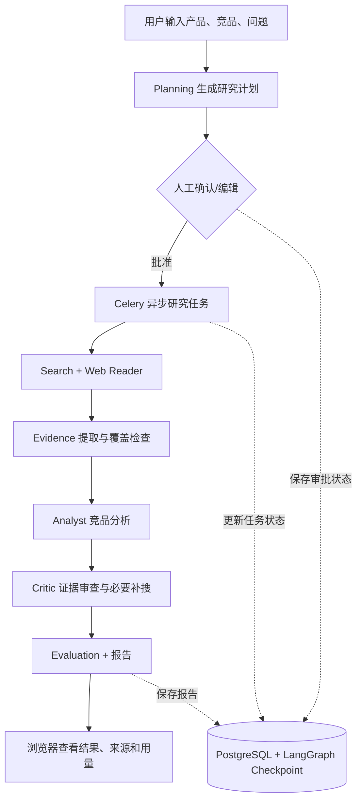

# ProductRadar · 竞品情报与产品决策 Agent

**让竞品研究从“逐页搜索、手动整理”变成“研究计划 → 人工确认 → 有证据的分析报告”。**

ProductRadar 是一个可自行配置并在本地启动的 **AI 应用原型（Demo / Portfolio Project）**，面向产品经理、独立开发者和小型产品团队：输入自己的产品、竞争对手和研究问题，系统会先提出研究计划，经人工确认后自动检索公开网页、提取证据、分析差异，并输出产品机会和 MVP 建议。

> **项目状态：可自行配置后本地运行的公开源码展示原型，不是已上线的 SaaS，也不提供免配置的在线服务。**实际研究需要使用者自己的 **DashScope 大模型 API Key** 与 **Tavily 搜索 API Key**，两者可能产生费用。生成内容可能不完整或不准确，应打开原文核实。没有声称任何真实用户量或未测量的准确率。

## 功能亮点

| 能力 | 用户能获得什么 |
| --- | --- |
| **研究规划 + 人工审批** | 先查看或编辑研究计划，再决定是否花费 API 配额执行 |
| **公开网页调研** | 搜索并读取公开页面，为竞品观点提供信息来源 |
| **Evidence（证据）约束** | 把关键事实与原始链接关联，减少无出处的判断 |
| **Analyst + Critic** | 形成竞品比较、差异化分析，再检查证据覆盖和结论缺口 |
| **覆盖检查与补搜** | 用“竞品 × 研究任务”的覆盖矩阵识别研究不足的部分 |
| **异步研究 + 断点恢复** | 长任务在 Worker 中执行，审批和研究状态持久化 |
| **个人工作区** | 邀请码注册、任务历史、报告查看、研究反馈与用量展示 |

## 一个实际使用场景

- **我的产品**：ProductRadar
- **竞争对手**：Klue、Crayon、Kompyte
- **研究问题**：这些产品如何追踪竞品动态、支持信息溯源及生成报告？对小团队而言，哪些能力最值得优先做成 MVP？

研究从 **生成研究计划**开始。你可以在网页中确认或修改任务，点击“批准并开始研究”后，页面会展示任务状态；完成后可以查看分析结论、证据及研究覆盖情况。

> MVP = Minimum Viable Product（最小可行产品），即先实现验证需求所必需的核心功能，而不是一次做完全部功能。

## 工作原理



**主要技术栈**：Python 3.11、FastAPI、LangGraph、PostgreSQL、SQLAlchemy / Alembic、Celery、Redis、原生 HTML/CSS/JavaScript、Docker Compose；可选 Caddy（公网 HTTPS）。

- **LangGraph**：把 AI 研究流程组织成可持久化的状态工作流。
- **Checkpoint（检查点）**：记录工作流状态，用于审批暂停、恢复和异常处理。
- **Worker（后台执行进程）**：独立执行可能花费数分钟的研究任务，避免浏览器请求长时间阻塞。
- **Evidence（证据）**：与关键事实相对应的网页文本及来源链接，不等于已获独立验证的真相。
- **Critic（检查阶段）**：对研究结论进行证据充分性和一致性检查，不应理解成能彻底消除幻觉。
- **Evaluation（评估）**：程序内的任务与证据质量指标；指标定义不代表已获得大规模第三方验证结果。

## 五分钟开始配置：Docker 本地运行（推荐）

**准备**：安装并启动 [Docker Desktop](https://www.docker.com/products/docker-desktop/)。需要可用的网络和自己的 DashScope / Tavily API Key。首次构建镜像、下载依赖及执行研究可能超过五分钟。

### 1. 下载并进入项目目录

```powershell
# 在已解压的 ProductRadar 目录内执行后续命令
cd ProductRadar
```

### 2. 生成私有配置

```powershell
python scripts/init_local_env.py
```

脚本**仅在 `.env` 不存在时**复制模板，并随机生成 `POSTGRES_PASSWORD`（本地数据库密码）与 `PRODUCTRADAR_INVITE_CODE`（本地注册邀请码）；不会生成模型 API Key，也不会覆盖已有配置。

如果没有安装本地 Python，可手动复制 `.env.example` 为 `.env`，并自行填写**足够随机**的数据库密码、邀请码与 API Key。

用文本编辑器打开 `.env`，填写这两项：

```dotenv
DASHSCOPE_API_KEY=替换成你自己的密钥
TAVILY_API_KEY=替换成你自己的密钥
```

保持 `PRODUCTRADAR_DOMAIN=` 为空、`PRODUCTRADAR_COOKIE_SECURE=false`。邀请码从你本地 `.env` 中获取，**不要放进 GitHub、截图或公开聊天记录**。

> API Key 由使用者自行申请，可能涉及付费。默认使用 `qwen3.5-plus`；如果你的 DashScope 账号不可使用这个模型，在 `.env` 修改 `QWEN_MODEL` 为你有权限使用的兼容模型。不会自动创建第三方账号或充值。

### 3. 启动整套本地服务

```powershell
docker compose up -d --build
```

Docker Compose 会启动 PostgreSQL、Redis、数据库迁移容器、API 与研究 Worker。

### 4. 浏览器打开

- **产品页面**：<http://localhost:8000>
- **接口说明（Swagger UI）**：<http://localhost:8000/docs>
- **就绪检查**：<http://localhost:8000/health/ready>（正常应返回 `{"status":"ready"}`）

第一次打开后，用 `.env` 中的 `PRODUCTRADAR_INVITE_CODE` **注册本地账号**（密码至少 12 位）；随后可以点击 **“填入示例问题”** 快速体验输入流程，再确认计划、运行研究并查看结果。示例按钮只填文字，**不会自动调用付费 API**。

> 本地 Docker 版本走 **HTTP + 仅绑定 `127.0.0.1` 的端口**，Cookie 故意不设置 `Secure`，以确保 localhost 能登录。这**不是公网部署方式**，不要通过端口映射或反向代理直接公开该配置。

### 5. 停止（保留数据）

```powershell
docker compose down
```

数据库与 Redis 使用 Docker volumes 保存状态，再次 `up` 后可继续使用。**不要随意执行 `docker compose down -v`：它会删除数据库等持久化数据。**

## 不用 Docker 构建 API：本地 Python 开发（可选）

适合想阅读、调试 Agent 代码的人。仍需 Docker 提供 PostgreSQL 和 Redis，**并同时运行 Web API 与 Celery Worker**。

```powershell
# 先生成 .env、填好 API Key；然后只启动数据库和队列
docker compose up -d postgres redis

# 安装依赖，建议 Python 3.11 专用虚拟环境
python -m venv .venv
.venv\Scripts\Activate.ps1
python -m pip install -r requirements.txt

# 启动 API（会执行数据库迁移，监听 127.0.0.1:8001）
python main.py
```

另开一个 PowerShell 终端、激活相同环境后运行：

```powershell
python -m celery -A worker.celery_app worker --loglevel=INFO --pool=solo
```

- 开发页面：<http://127.0.0.1:8001>
- Windows 建议 `--pool=solo`，因为 Celery 默认的多进程池在 Windows 上存在兼容性限制。
- 如 PowerShell 不允许激活环境，可使用 `.venv\Scripts\python.exe` 直接执行命令。
- **两种运行方式选其一**：不要同时启动 Docker 中的 API/Worker 和本地同类进程来运行同一个任务。

## 配置速查

| 变量 | 用途 | 是否必需 |
| --- | --- | --- |
| `DASHSCOPE_API_KEY` | 生成计划、研究、分析、评估等模型请求 | 执行研究必需 |
| `TAVILY_API_KEY` | 搜索公开网页 | 执行研究必需 |
| `POSTGRES_PASSWORD` | PostgreSQL 连接密码 | 本地启动必需，初始化脚本可生成 |
| `PRODUCTRADAR_INVITE_CODE` | 注册本地演示账号 | 新账号注册必需，初始化脚本可生成 |
| `QWEN_MODEL` | 默认使用的大模型 | 可选；默认 `qwen3.5-plus` |
| `PRODUCTRADAR_COOKIE_SECURE` | HTTPS 时是否只允许安全 Cookie | 本地 HTTP 为 `false`；公网 HTTPS 为 `true` |
| `QWEN_INPUT_PRICE_PER_MILLION_CNY` / `QWEN_OUTPUT_PRICE_PER_MILLION_CNY` | 界面中的模型成本**估算**单价 | 可选；0 代表未配置 |

其它研究预算、阶段模型路由和备选模型配置请参考 `.env.example`。**不要把真实密钥写进源代码。**

## 常见问题

**网页可以打开，但点击生成研究计划报错？**

先检查 `.env` 中两个必需 API Key 是否正确、对应服务是否可用，以及模型名称是否属于你的可用范围。仅能打开网页**不等于**已配置好外部模型与搜索服务。

**注册失败 / 一直处于未登录状态？**

本地 Docker 请使用 `http://localhost:8000`（而不是任意公网域名），并使用 `.env` 里的邀请码。确认使用的是本项目打包后的本地 Compose 配置，而不是旧版强制开启 `Secure Cookie` 的配置。

**任务一直停在排队或研究中？**

先检查 Docker Desktop 是否已启动、Worker 是否运行、Redis/PostgreSQL 是否可用，再检查第三方接口调用是否成功。可以用 `docker compose ps` 查看容器状态；有需要时再查看对应 API/Worker 日志。大模型调用和网页读取时间不固定。

**我改过 `.env` 里的数据库密码，然后突然连不上？**

PostgreSQL 持久化卷创建以后，再修改 Compose 的密码环境变量**不会自动修改数据库内部密码**。要么恢复原密码，要么自行修改数据库账号密码。`down -v` 会清空旧数据，只有确认不需要数据后才考虑。

**没有 API Key 能离线看完整研究结果吗？**

目前不提供虚构的“假研究结果”离线模式。你可以查看代码和页面结构，但产生真实新报告必须配置模型与搜索服务。

## 公开部署：仅限自行评估的高级选项

当前代码提供可选的 Caddy HTTPS 入口，但**不代表经过生产安全审计，也不保证高可用**。在公开前至少检查域名/DNS、HTTPS、账号注册策略、数据备份、日志脱敏、API 消费限额和第三方服务条款。

将你的真实域名写入本地 `.env` 的 `PRODUCTRADAR_DOMAIN`，配置域名 DNS 指向有公网 IP 的服务器、放行 80/443 端口，并使用以下**叠加配置**强制开启 HTTPS 专用 Cookie：

```bash
docker compose -f docker-compose.yml -f docker-compose.public.yml --profile public up -d --build
```

**切勿**直接将默认 `docker compose up` 的 localhost HTTP 配置暴露到公网。也不要使用 `localhost` 或无效域名作为公网域名。公开实例建议先采用小范围邀请制，不要把邀请码发在仓库里。

## 项目目录

```text
ProductRadar/
├── frontend/                 # 研究工作台（原生 HTML/CSS/JS）
├── main.py                   # FastAPI 接口与入口
├── auth.py                   # 账号、登录、会话、CSRF 保护
├── agent.py                  # 调研 Agent 主逻辑
├── search_tool.py            # 公开搜索
├── web_reader.py             # 安全网页读取
├── evidence.py               # 证据处理
├── analysis.py               # 竞品分析
├── critic.py                 # 证据质量检查
├── evaluation.py             # 研究质量评估
├── research_coverage.py      # 覆盖矩阵与补搜流程
├── workflow.py               # LangGraph 状态工作流
├── worker.py                 # Celery 后台任务
├── database.py               # 业务数据持久化
├── migrations/               # Alembic 数据迁移
├── scripts/init_local_env.py # 创建私有本地配置（不上传密钥）
├── docker-compose.yml        # 本地运行栈
└── docker-compose.public.yml # 公网 HTTPS 覆盖配置
```

## 边界与后续方向

- 目前是**需要 API Key 的本地 Demo**，不含真实商业客户、正式 SLA 或公开可访问的部署地址。
- 网页读取仅针对能够公开访问的普通页面；付费墙、登录保护、动态渲染与反爬策略可能导致信息不完整。
- 证据引用、Critic 和 Evaluation 能改善可追溯性，但**不能保证结论完全正确**；正式业务决策前需要人工核验。
- 研究过程会消耗外部模型与搜索配额，预算限制是防止异常消费的辅助机制，不等于第三方账单上限。
- 后续可以补充真实公开演示地址、页面截图、固定评测任务及经过验证的效果指标；当前不虚构上述数据。

## GitHub 发布前检查

1. 仓库仅包含代码、配置模板和必要文档；不要上传 `.env`、数据库文件、虚拟环境、IDE 配置、缓存或真实用户数据。
2. 如果密钥曾进入任何 Git 提交记录，**仅删除当前文件不够**：必须先撤销/轮换密钥，并按需清理历史。
3. 公开前自己用一台干净的机器按照“Docker 本地运行”步骤安装一次，确认自己的密钥、账号及网络条件都能走完流程。
4. 自行决定是否添加合适的 LICENSE（开源许可证）；未添加前，不应擅自声称采用了某一种开源许可。

---

**项目定位**：真实可扩展的 AI 应用工程练习，重点展示“研究工作流、证据约束、状态恢复和工程可用性”，而非承诺已商业化上线。
